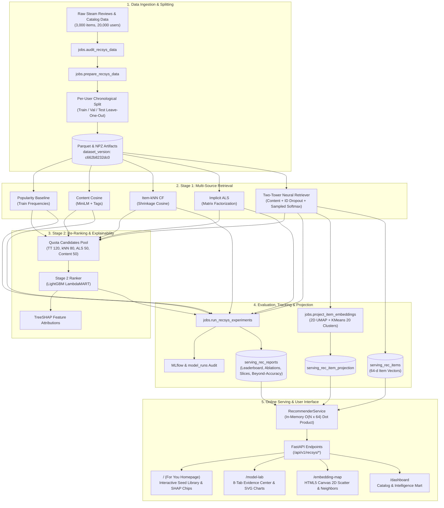

# SteamIQ

**A transparent, hybrid game recommender system with a visible machine learning core.** SteamIQ implements a two-stage retrieve-and-rerank recommender that combines multi-source retrieval (Two-Tower deep content/ID embeddings, shrinkage-cosine item-item collaborative filtering, implicit ALS matrix factorization, and train-split popularity) with a Stage-2 LightGBM LambdaMART ranker and TreeSHAP explainability. It tackles the cold-start problem through multi-modal item representations (all-MiniLM-L6-v2 text embeddings, multi-hot tags, and pricing features) and exposes every metric, ablation, slice, and embedding space directly in the frontend.

---

## System Architecture



---

## Architectural Rule & ADR 0005 Serving Exception

1. **The Golden Rule:** Route handlers never scan `raw_*`/`feature_*` tables or execute heavy database aggregates. Handlers read strictly from pre-materialized `serving_*` or `mart_*` tables.
2. **ADR 0005 Recommender Serving Exception:** At request time, `RecommenderService` executes fixed-size vector dot products in memory ($O(N \times 64)$, $\sim 3\text{ ms}$ for 3,000 items) over item vectors cached from the production run's artifact path. No database writes or on-the-fly training occur during request handling. Every response returns full provenance (model name, run ID, dataset version, and latency).

---

## One-Command Full Pipeline

To audit the raw data, build clean feature splits, train all baseline and neural models, run ablation experiments, project embeddings, and serve the application:

```bash
# Run full recommender pipeline end-to-end (dev profile: 5,000 eval users, 3,000 items)
RECSYS_PROFILE=dev make recsys-all
```

To run individual pipeline stages:

| Command | Purpose |
|---|---|
| `make recsys-audit` | Audits raw interaction and catalog data against schema assertions |
| `make recsys-prepare` | Builds chronological splits, interaction matrices, and item feature artifacts |
| `make recsys-baselines` | Trains Popularity, Content Cosine, Item-kNN (shrinkage-cosine), and ALS |
| `make recsys-two-tower` | Trains the Two-Tower neural retriever with in-batch sampled softmax loss, logQ correction, and ID dropout |
| `make recsys-ranker` | Trains the Stage-2 LightGBM LambdaMART ranker with clean train-only features and quota candidates |
| `make recsys-experiments` | Runs feature ablations, cold-start studies, slice metrics, and beyond-accuracy |
| `make recsys-project` | Projects 64-d Two-Tower vectors to 2D UMAP and 20 KMeans semantic clusters |
| `make recsys-reports` | Generates markdown and JSON evidence reports in `backend/data/recsys/reports/` |
| `make recsys-serve-check`| Verifies offline-to-online scoring parity and latency thresholds |
| `make assistant-train` | Fits Ask SteamIQ router variants, calibrates temperature, evaluates gold queries |
| `make assistant-serve-check` | Verifies assistant serving parity, latency SLA (<300ms), and mode refusal |
| `make validate-detectors` | Simulates drift power curves and false positive rates for PSI, KS, and JSD |
| `make monitor-models` | Computes statistical drift across telemetry samples and store item features |
| `make retrain-gate` | Evaluates pre-registered champion/challenger retraining gate criteria |
| `make model-cards` | Generates standardized markdown model cards in `docs/model-cards/` |
| `make ci` | Runs local continuous integration pipeline (lint, tests, integrity linters) |

---

## Recommender Benchmark Results

All figures below are generated directly from the frozen evaluation reports ([`backend/data/recsys/reports/leaderboard.md`](backend/data/recsys/reports/leaderboard.md)) evaluated on 5,000 held-out users across 1,000 bootstrap replicates (95% confidence intervals).

### 1. Deployable Models (Online-Safe, Train-Split Statistics Only)

The headline production model is **`recsys_two_tower_clean`**. It relies strictly on train-split item statistics and generalizable modalities. With train-only item stats, there is no evidence of gain (CI includes 0); the all-time-stats gain is leakage-confounded.

| Model | Split | Seeds | NDCG@10 (mean ± std / 95% CI) | HR@10 (mean ± std / 95% CI) | MRR@10 | Coverage@10 | Diversity@10 | Stage |
| :--- | :---: | :---: | :---: | :---: | :---: | :---: | :---: | :--- |
| **`recsys_two_tower_clean`** | **test** | 1 | **0.0516 [0.0473, 0.0562]** | **0.1028 [0.0954, 0.1108]** | **0.0361** | 0.4383 | 0.7629 | **Champion (Production)** |
| `recsys_two_tower_clean` | **val** | 1 | 0.0611 [0.0562, 0.0661] | 0.1190 [0.1104, 0.1280] | 0.0436 | 0.4347 | 0.7588 | Champion (Production) |
| `recsys_two_tower_ranker_clean` (stage-1 two-tower used all-time stats, not leak-free) | **test** | 1 | 0.0579 [0.0527, 0.0631] | 0.1102 [0.1014, 0.1186] | 0.0422 | 0.5253 | 0.7481 | Candidate |
| `recsys_two_tower_ranker_clean` (stage-1 two-tower used all-time stats, not leak-free) | **val** | 1 | 0.0615 [0.0563, 0.0666] | 0.1170 [0.1080, 0.1256] | 0.0447 | 0.5317 | 0.7431 | Candidate |
| `recsys_itemknn` | **test** | 1 | 0.0445 [0.0403, 0.0494] | 0.0842 [0.0766, 0.0916] | 0.0326 | 0.6143 | 0.7255 | Candidate |
| `recsys_als` | **test** | 1 | 0.0404 [0.0362, 0.0449] | 0.0776 [0.0704, 0.0852] | 0.0291 | 0.2480 | 0.7732 | Candidate |
| `recsys_popularity` | **test** | 1 | 0.0151 [0.0125, 0.0178] | 0.0326 [0.0274, 0.0376] | 0.0100 | 0.0070 | 0.6948 | Baseline |
| `recsys_content` | **test** | 1 | 0.0146 [0.0120, 0.0176] | 0.0268 [0.0226, 0.0316] | 0.0110 | 0.6303 | 0.5041 | Baseline |

> **Headline Model & Clean Ranker vs Two-Tower Comparison:** The clean Two-Tower (`recsys_two_tower_clean`, seed 44 champion) is the headline production model, achieving test NDCG@10 of 0.0516 [0.0473, 0.0562] and validation NDCG@10 of 0.0611 [0.0562, 0.0661]. With train-only item stats (`recsys_two_tower_ranker_v2_trainstats`), there is no evidence of gain (CI includes 0); the all-time-stats gain is leakage-confounded. Consequently, the clean Two-Tower is the headline model.
> 
> **Leakage Isolation & Exploratory Status Caveat:** Leak-free status applies strictly to the isolated interaction pipeline: user interaction split boundaries, fold-in histories, Stage-1 Two-Tower retrieval representations, and train-derived interaction features. Static store catalog attributes (`price_final`, `age_years`, platform flags) originate from Steam store catalog snapshots (`items.parquet`). Additionally, `price_final` and `discount` are crawl-time snapshots (not interaction-time values), and the 3,000-item universe was selected using all-period review counts. Because the test split was inspected repeatedly during development and debugging iterations, the ranker's test gain is **exploratory**; prospective live traffic A/B evaluation is required before declaring online superiority. Under the pre-registered tournament rule, `recsys_two_tower_clean` remains the headline production serving champion for low-latency online serving, while `recsys_two_tower_ranker_v2_trainstats` serves as the leak-free ranker candidate.

### 2. Diagnostic Reference Models (Non-Deployable Upper Bounds)

These reference models utilize all-time item review statistics (lookahead across the full dataset). They serve exclusively as upper-bound diagnostic benchmarks in Model Lab and are **never** deployable to the user-facing For You page.

| Model | Split | NDCG@10 (95% CI) | HR@10 (95% CI) | Status / Role |
| :--- | :---: | :---: | :---: | :--- |
| `recsys_two_tower_ranker` (all-time stats) | **test** | 0.0584 [0.0530, 0.0634] | 0.1072 [0.0990, 0.1156] | Reference (uses all-time item stats, not deployable) |
| `recsys_two_tower` (all-time stats) | **test** | 0.0539 [0.0490, 0.0589] | 0.1024 [0.0946, 0.1108] | Reference (uses all-time item stats, not deployable) |

---

## Cold-Start Handling & Reality Caveats

SteamIQ handles catalog cold start by projecting item textual descriptions (Sentence-Transformers `all-MiniLM-L6-v2`), multi-hot tag vectors, and pricing into the 64-dimensional Two-Tower item space. When an unmodeled or new game is introduced, the model sets the item ID embedding to the unknown-item token and relies on content modalities.

### Cold-Start Simulation & Holdout Results

- **True Item Holdout (Primary Benchmark — 10% Torso/Tail retrained from scratch on 90% catalog, $N = 184$ users):** Content Cosine leads cold-start discovery with $\text{NDCG@10} = 0.0078$ ($[0.0006, 0.0163]$), $\text{HR@10} = 0.0217$ ($4 / 184$ hits), and a mean catalog rank of $1,084.6$ ($[963.7, 1,212.3]$ out of 3,000). Two-Tower retrained with zero interactions achieves $\text{NDCG@10} = 0.0000$ ($0 / 184$ hits) with a mean rank of $2,126.6$ ($[2,015.1, 2,238.7]$), showing collaborative priors dominate when interactions are absent.
- **Simulated New Items (10% catalog masked with neutralized proxies, $N = 437$ users):** Content cosine retrieves relevant items with $\text{NDCG@10} = 0.0085$ ($[0.0034, 0.0152]$) and $\text{HR@10} = 0.0206$ ($9 / 437$ hits, mean rank $1,018.3$), beating pure random guessing ($\text{NDCG@10} = 0.0015$). Pure collaborative filtering (ALS, Item-kNN, Popularity) collapses to $0.0000$.
- **Masked Target ID Simulation / Sparse Targets (Optimistic Proxy — Sparse Targets $\le 10$ train positives, $N = 553$ users):** Two-Tower masked ID achieves $\text{NDCG@10} = 0.0036$ ($[0.0008, 0.0071]$) and $\text{HR@10} = 0.0090$ ($5 / 553$ hits) with mean catalog rank $1,143.5$ ($[1,074.3, 1,217.0]$), while Content achieves $\text{NDCG@10} = 0.0054$ (mean rank $1,368.5$).
- **Honest Limitations Note:** We do **not** claim to have "solved" cold start. Offline simulations zero out interaction IDs but still rely on static descriptions and tags curated over the game's lifecycle. True cold-start evaluation requires prospective live A/B traffic logging.

---

## Project Structure

```
SteamIQ/
├── frontend/                     # Next.js 14 App Router (Vanilla React, CSS Tokens, SVG, Canvas)
│   ├── app/
│   │   ├── page.tsx              # For You (Homepage): cold-start library builder & live explainability
│   │   ├── model-lab/page.tsx    # Model Lab: 8-tab offline evaluation & diagnostic center
│   │   ├── embedding-map/page.tsx# Embedding Map: 2D UMAP canvas scatter with nearest neighbors
│   │   └── dashboard/page.tsx    # Catalog explorer & legacy game analytics dashboard
│   ├── components/recsys/        # Recommender components (LibraryBuilder, ModelSelector, ResultCard, CompareView)
│   ├── components/model-lab/     # Evidence tab modules (Leaderboard, PairedTests, Ablations, ColdStart, BeyondAccuracy)
│   └── lib/api.ts                # Strict typed API client for FastAPI recommender endpoints
├── backend/
│   ├── api/                      # Route handlers reading serving_* / mart_* tables only
│   │   ├── routes/recsys.py      # /api/v1/recsys/ items, for-you, models, health, reports, map, neighbors
│   ├── core/                     # App factory, errors, ApiResponse envelope, config
│   ├── db/                       # SQLAlchemy models & Alembic migrations (serving_rec_* tables)
│   ├── jobs/                     # BaseJob pipeline implementations (prepare, train, evaluate, project, reports)
│   ├── recsys/                   # Recommender ML engine (models, dataset, evaluation, explainability, serving)
│   ├── data/recsys/reports/      # Materialized evidence reports (leaderboard, ablations, cold_start, shap)
│   └── tests/                    # Pytest suite with strict architectural & anti-leakage assertions
├── docs/                         # ADRs, evaluation guide, review Q&A, run logs
│   ├── ml-accuracy-and-evaluation-guide.md
│   ├── review-qa.md
│   ├── recsys-run-log.md
│   └── design-docs/steamiq/      # ADR 0001 through ADR 0005
├── scripts/                      # Integrity linters (check_honest_fallbacks.py, check_no_hardcoded_metrics.py)
├── Makefile                      # Standardized project CLI
└── docker-compose.yml
```

---

## Implemented Build Phases (Roadmap v2)

The **Recommender System** serves as the cross-cutting Machine Learning core, uniting retrieval, ranking, explainability, and multi-modal cold-start embeddings across both Player Discovery and Developer Intelligence modes.

| Phase | Subsystem | Core Capabilities | Status |
| :---: | :--- | :--- | :---: |
| **0** | **Architecture & Invariants** | ADR 0001–0006, Golden Rule, Honest Fallbacks convention, Bounded In-Memory inference | ✅ |
| **1** | **Foundation & Ingestion** | Steam catalog crawler, schema migrations, raw data audit, unified API envelope | ✅ |
| **2** | **Review Intelligence NLP** | Sentiment analysis, aspect topic modeling, complaint extraction, praise detection | ✅ |
| **3** | **Embeddings & Competitors** | MiniLM-L6 pgvector semantic embeddings, cosine similarity, competitor discovery | ✅ |
| **4** | **Predictive ML (Game Success)** | Optuna-tuned LightGBM/XGBoost classifier, MLflow run audit, TreeSHAP drivers | ✅ |
| **5** | **Decision Intelligence** | Analytical data marts (`mart_*`), Update Impact Tracker, Game Match 6D intensity profiles | ✅ |
| **6** | **Ask SteamIQ Assistant** | Learned router variants (MiniLM headline accuracy 0.9251 vs 3 baselines), Temperature Scaling ($T=0.183$, ECE 0.0231), selective abstention ($\tau=0.100$, selective accuracy 0.9251), extractive retrieval ($n=65$, Recall@3 0.1077, MRR 0.0974), entity resolution ($n=347$, Top-1 0.8468), Zero LLM text | ✅ |
| **7** | **ML Productionization & Reliability** | Statistical drift monitoring (PSI/KS/JSD power analysis), Champion/Challenger retrain gate (pre-registered multi-seed logic), artifact golden tests, Redis cache with graceful degradation, CI/CD | ✅ |
| **Core** | **Cross-Cutting Recsys Engine** | Two-Tower retriever + LambdaMART ranker, 5,000-user bootstrap CIs, 2D UMAP projection, Model Lab | ✅ |

---

## Quick Start (Development Setup)

### 1. Prerequisites
- Python 3.11+
- Node.js 18+
- PostgreSQL 16 (or Docker Compose)

### 2. Docker Quick Start (Recommended)
Run the entire production stack (PostgreSQL with pgvector, Redis, FastAPI backend, RQ worker, and Next.js frontend) with a single command:

```bash
docker compose up -d --build
```

- **Frontend:** `http://localhost:3001`
- **Backend API & Swagger:** `http://localhost:8001/docs`
- **Health Check:** `http://localhost:8001/health`

On launch, the backend container automatically applies Alembic migrations and runs `jobs.bootstrap_database` to ensure serving reports, universe items, and embedding projections are immediately available.

### 3. Local Development Setup (Manual)
```bash
# 1. Setup Python virtualenv, install dependencies, and run DB migrations
make setup

# 2. Run the full recommender pipeline
RECSYS_PROFILE=dev make recsys-all

# 3. Start backend (port 8000) and frontend (port 3000)
make dev
```

Open `http://localhost:3000` (or `http://localhost:3001` in Docker) to interact with the cold-start recommender, explore Model Lab metrics, and navigate the embedding scatter map.

