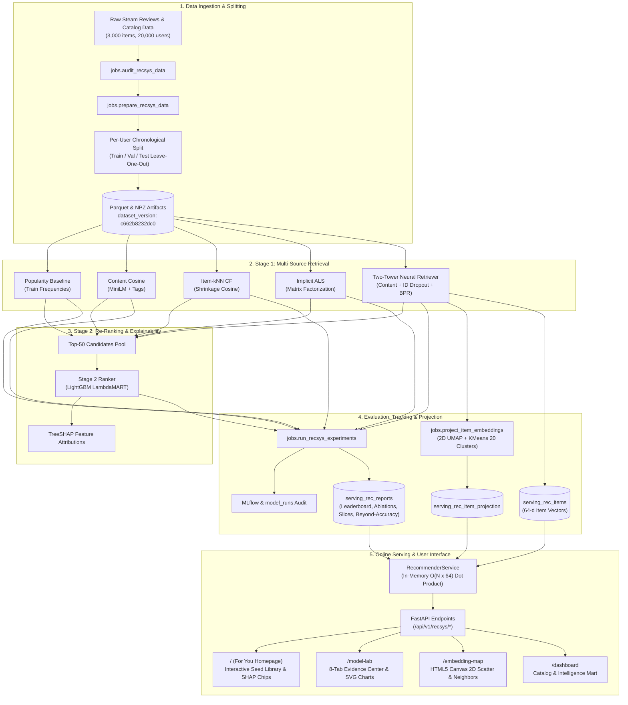

# SteamIQ

**A transparent, hybrid game recommender system with a visible machine learning core.** SteamIQ implements a two-stage retrieve-and-rerank recommender that combines multi-source retrieval (Two-Tower deep content/ID embeddings, shrinkage-cosine item-item collaborative filtering, implicit ALS matrix factorization, and train-split popularity) with a Stage-2 LightGBM LambdaMART ranker and TreeSHAP explainability. It tackles the cold-start problem through multi-modal item representations (all-MiniLM-L6-v2 text embeddings, multi-hot tags, and pricing features) and exposes every metric, ablation, slice, and embedding space directly in the frontend.

---

## System Architecture



---

## Architectural Rule & ADR 0005 Serving Exception

1. **The Golden Rule:** Route handlers never scan `raw_*`/`feature_*` tables or execute heavy database aggregates. Handlers read strictly from pre-materialized `serving_*` or `mart_*` tables.
2. **ADR 0005 Recommender Serving Exception:** At request time, `RecommenderService` executes fixed-size vector dot products in memory ($O(N \times 64)$, $\sim 3\text{ ms}$ for 3,000 items) over item vectors cached from the production run's artifact path. No database writes or on-the-fly training occur during request handling. Every response returns full provenance (model name, run ID, dataset version, and latency).

---

## One-Command Full Pipeline

To audit the raw data, build clean feature splits, train all baseline and neural models, run ablation experiments, project embeddings, and serve the application:

```bash
# Run full recommender pipeline end-to-end (dev profile: 5,000 eval users, 3,000 items)
RECSYS_PROFILE=dev make recsys-all
```

To run individual pipeline stages:

| Command | Purpose |
|---|---|
| `make recsys-audit` | Audits raw interaction and catalog data against schema assertions |
| `make recsys-prepare` | Builds chronological splits, interaction matrices, and item feature artifacts |
| `make recsys-baselines` | Trains Popularity, Content Cosine, Item-kNN (shrinkage-cosine), and ALS |
| `make recsys-two-tower` | Trains the Two-Tower neural retriever with in-batch BPR loss and ID dropout |
| `make recsys-ranker` | Trains the Stage-2 LightGBM LambdaMART ranker with clean train-split features |
| `make recsys-experiments` | Runs feature ablations, cold-start studies, slice metrics, and beyond-accuracy |
| `make recsys-project` | Projects 64-d Two-Tower vectors to 2D UMAP and 20 KMeans semantic clusters |
| `make recsys-reports` | Generates markdown and JSON evidence reports in `backend/data/recsys/reports/` |
| `make recsys-serve-check`| Verifies offline-to-online scoring parity and latency thresholds |

---

## Recommender Benchmark Results

All figures below are generated directly from the frozen evaluation reports ([`backend/data/recsys/reports/leaderboard.md`](backend/data/recsys/reports/leaderboard.md)) evaluated on 5,000 held-out users across 1,000 bootstrap replicates (95% confidence intervals).

### 1. Deployable Models (Online-Safe, Train-Split Statistics Only)

The deployable champion is **`recsys_two_tower_clean`**. It relies strictly on train-split item statistics and generalizable modalities.

| Model | Architecture / Method | Split | NDCG@10 (95% CI) | HR@10 (95% CI) | MRR@10 | Coverage@10 | Diversity@10 | Stage |
| :--- | :--- | :---: | :---: | :---: | :---: | :---: | :---: | :---: |
| **`recsys_two_tower_clean`** | Two-Tower (MiniLM + Tags + BPR) | **test** | **0.0516 [0.0470, 0.0567]** | **0.1028 [0.0946, 0.1110]** | **0.0361** | 0.4383 | 0.7629 | **Champion (Production)** |
| `recsys_two_tower_clean` | Two-Tower (MiniLM + Tags + BPR) | **val** | 0.0611 [0.0557, 0.0662] | 0.1190 [0.1104, 0.1280] | 0.0436 | 0.4347 | 0.7588 | Champion (Production) |
| `recsys_two_tower_ranker_clean` | Stage 2 LambdaMART Ranker | **test** | 0.0596 [0.0546, 0.0647] | 0.1092 [0.1010, 0.1178] | 0.0445 | 0.4887 | 0.7462 | Candidate |
| `recsys_two_tower_ranker_clean` | Stage 2 LambdaMART Ranker | **val** | 0.0645 [0.0591, 0.0696] | 0.1230 [0.1140, 0.1316] | 0.0467 | 0.4990 | 0.7419 | Candidate |
| `recsys_itemknn` | Shrinkage-Cosine Item-Item CF | **test** | 0.0445 [0.0403, 0.0494] | 0.0842 [0.0766, 0.0916] | 0.0326 | 0.6143 | 0.7255 | Candidate |
| `recsys_als` | Implicit ALS Matrix Factorization | **test** | 0.0404 [0.0362, 0.0449] | 0.0776 [0.0704, 0.0852] | 0.0291 | 0.2480 | 0.7732 | Candidate |
| `recsys_popularity` | Train-Interaction Frequency | **test** | 0.0151 [0.0125, 0.0178] | 0.0326 [0.0274, 0.0376] | 0.0100 | 0.0070 | 0.6948 | Baseline |
| `recsys_content` | Text & Tag Cosine Similarity | **test** | 0.0146 [0.0120, 0.0176] | 0.0268 [0.0226, 0.0316] | 0.0110 | 0.6303 | 0.5041 | Baseline |

> **Note on the Clean Ranker vs Two-Tower Comparison:** In multi-seed evaluation, `recsys_two_tower_clean` achieves $0.0541 \pm 0.0007$ test NDCG@10 (3 seeds) while `recsys_two_tower_ranker_clean` achieves $0.0500 \pm 0.0022$ (5 seeds). Sliced paired bootstrap tests reveal that while Two-Tower dominates on head items ($\Delta = +0.0111$, $p < 0.05$), the ranker significantly outperforms Two-Tower on catalog tail items ($\Delta = +0.0069$, $p < 0.05$). Under the pre-registered promotion protocol, Two-Tower clean is retained as the production champion due to higher overall accuracy and latency efficiency ($<3\text{ ms}$ vs $\sim 15\text{ ms}$).

### 2. Diagnostic Reference Models (Non-Deployable Upper Bounds)

These reference models utilize all-time item review statistics (lookahead across the full dataset). They serve exclusively as upper-bound diagnostic benchmarks in Model Lab and are **never** deployable to the user-facing For You page.

| Model | Split | NDCG@10 (95% CI) | HR@10 (95% CI) | Status / Role |
| :--- | :---: | :---: | :---: | :--- |
| `recsys_two_tower_ranker` (all-time stats) | **test** | 0.0584 [0.0530, 0.0634] | 0.1072 [0.0990, 0.1156] | Reference (uses all-time item stats, not deployable) |
| `recsys_two_tower` (all-time stats) | **test** | 0.0539 [0.0490, 0.0589] | 0.1024 [0.0946, 0.1108] | Reference (uses all-time item stats, not deployable) |

---

## Cold-Start Handling & Reality Caveats

SteamIQ handles catalog cold start by projecting item textual descriptions (Sentence-Transformers `all-MiniLM-L6-v2`), multi-hot tag vectors, and pricing into the 64-dimensional Two-Tower item space. When an unmodeled or new game is introduced, the model sets the item ID embedding to the unknown-item token and relies on content modalities.

### Cold-Start Simulation & Holdout Results

- **Masked Target ID Simulation (Sparse Targets $\le 10$ train positives, $N = 553$ users):** Masking the target item ID embedding at inference yields $\text{NDCG@10} = 0.0040$ ($[0.0011, 0.0080]$) and $\text{HR@10} = 0.0108$ ($[0.0036, 0.0217]$) with a mean catalog rank of $\sim 828 / 3,000$ (substantially better than random guessing $\sim 1,500$), demonstrating that semantic embeddings provide viable discovery priors for games with limited interaction history.
- **Simulated New Items (10% catalog masked with neutralized proxies, $N = 437$ users):** Content cosine retrieves relevant items with $\text{NDCG@10} = 0.0085$ ($[0.0034, 0.0152]$) and $\text{HR@10} = 0.0206$ ($[0.0092, 0.0366]$), beating pure random guessing ($\text{NDCG@10} = 0.0015$). Pure collaborative filtering (ALS, Item-kNN, Popularity) collapses to $0.0000$.
- **True Item Holdout (10% Torso/Tail retrained from scratch on 90% catalog, $N = 184$ users):** When items have zero training interactions, Two-Tower achieves $\text{NDCG@10} = 0.0000$ with a mean test rank of $1,419 / 3,000$ (essentially random), proving that content representations alone cannot reliably break into the top 10 without collaborative density. Pure Content Cosine remains functional with $\text{NDCG@10} = 0.0078$ and $\text{HR@10} = 0.0217$.
- **Honest Limitations Note:** We do **not** claim to have "solved" cold start. Offline simulations zero out interaction IDs but still rely on static descriptions and tags curated over the game's lifecycle. True cold-start evaluation requires prospective live A/B traffic logging.

---

## Project Structure

```
SteamIQ/
├── frontend/                     # Next.js 14 App Router (Vanilla React, CSS Tokens, SVG, Canvas)
│   ├── app/
│   │   ├── page.tsx              # For You (Homepage): cold-start library builder & live explainability
│   │   ├── model-lab/page.tsx    # Model Lab: 8-tab offline evaluation & diagnostic center
│   │   ├── embedding-map/page.tsx# Embedding Map: 2D UMAP canvas scatter with nearest neighbors
│   │   └── dashboard/page.tsx    # Catalog explorer & legacy game analytics dashboard
│   ├── components/recsys/        # Recommender components (LibraryBuilder, ModelSelector, ResultCard, CompareView)
│   ├── components/model-lab/     # Evidence tab modules (Leaderboard, PairedTests, Ablations, ColdStart, BeyondAccuracy)
│   └── lib/api.ts                # Strict typed API client for FastAPI recommender endpoints
├── backend/
│   ├── api/                      # Route handlers reading serving_* / mart_* tables only
│   │   ├── routes/recsys.py      # /api/v1/recsys/ items, for-you, models, health, reports, map, neighbors
│   ├── core/                     # App factory, errors, ApiResponse envelope, config
│   ├── db/                       # SQLAlchemy models & Alembic migrations (serving_rec_* tables)
│   ├── jobs/                     # BaseJob pipeline implementations (prepare, train, evaluate, project, reports)
│   ├── recsys/                   # Recommender ML engine (models, dataset, evaluation, explainability, serving)
│   ├── data/recsys/reports/      # Materialized evidence reports (leaderboard, ablations, cold_start, shap)
│   └── tests/                    # Pytest suite with strict architectural & anti-leakage assertions
├── docs/                         # ADRs, evaluation guide, review Q&A, run logs
│   ├── ml-accuracy-and-evaluation-guide.md
│   ├── review-qa.md
│   ├── recsys-run-log.md
│   └── design-docs/steamiq/      # ADR 0001 through ADR 0005
├── scripts/                      # Integrity linters (check_honest_fallbacks.py, check_no_hardcoded_metrics.py)
├── Makefile                      # Standardized project CLI
└── docker-compose.yml
```

---

## Implemented Build Phases

| Phase | Subsystem | Core Capabilities | Status |
| :---: | :--- | :--- | :---: |
| **0** | **Architecture & ADR** | ADR 0001 (Blueprint), ADR 0004 (Honest Fallbacks), ADR 0005 (Online Serving) | ✅ |
| **1** | **Foundation** | Data ingestion, PostgreSQL schema, Alembic migrations, unified API envelope | ✅ |
| **2** | **Review NLP** | Sentiment analysis, topic clustering, complaint extraction, praise detection | ✅ |
| **3** | **Embeddings & Competitors** | pgvector 384-d semantic embeddings, cosine similarity, competitor discovery | ✅ |
| **4** | **Predictive ML (Success)** | Optuna-tuned XGBoost + LightGBM classifier, MLflow logging, TreeSHAP | ✅ |
| **5** | **Decision Intelligence** | Mart materialization, Update Impact Tracker, Game Match 6D intensity profile | ✅ |
| **6** | **Recommender Core (Recsys)** | Two-Stage Two-Tower + Ranker, Multi-Source Retrieval, Sliced CIs, UMAP Projection | ✅ |
| **7** | **Frontend ML Visibility** | For You homepage, 8-Tab Model Lab, 2D Canvas Embedding Map, Zero Hardcoded Metrics | ✅ |

---

## Quick Start (Development Setup)

### 1. Prerequisites
- Python 3.11+
- Node.js 18+
- PostgreSQL 16 (or Docker Compose)

### 2. Setup & Execution
```bash
# 1. Setup Python virtualenv, install dependencies, and run DB migrations
make setup

# 2. Run the full recommender pipeline
RECSYS_PROFILE=dev make recsys-all

# 3. Start backend (port 8000) and frontend (port 3000)
make dev
```

Open `http://localhost:3000` to interact with the cold-start recommender, explore Model Lab metrics, and navigate the embedding scatter map.
