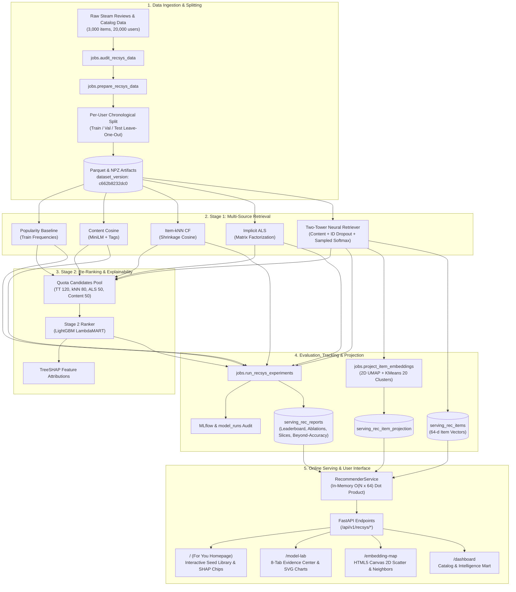

# SteamIQ

**A transparent, hybrid game recommender system with a visible machine learning core.** SteamIQ implements a two-stage retrieve-and-rerank recommender that combines multi-source retrieval (Two-Tower deep content/ID embeddings, shrinkage-cosine item-item collaborative filtering, implicit ALS matrix factorization, and train-split popularity) with a Stage-2 LightGBM LambdaMART ranker and TreeSHAP explainability. It tackles the cold-start problem through multi-modal item representations (all-MiniLM-L6-v2 text embeddings, multi-hot tags, and pricing features) and exposes every metric, ablation, slice, and embedding space directly in the frontend.

---

## System Architecture



---

## Architectural Rule & ADR 0005 Serving Exception

1. **The Golden Rule:** Route handlers never scan `raw_*`/`feature_*` tables or execute heavy database aggregates. Handlers read strictly from pre-materialized `serving_*` or `mart_*` tables.
2. **ADR 0005 Recommender Serving Exception:** At request time, `RecommenderService` executes fixed-size vector dot products in memory ($O(N \times 64)$, $\sim 3\text{ ms}$ for 3,000 items) over item vectors cached from the production run's artifact path. No database writes or on-the-fly training occur during request handling. Every response returns full provenance (model name, run ID, dataset version, and latency).

---

## One-Command Full Pipeline

To audit the raw data, build clean feature splits, train all baseline and neural models, run ablation experiments, project embeddings, and serve the application:

```bash
# Run full recommender pipeline end-to-end (dev profile: 5,000 eval users, 3,000 items)
RECSYS_PROFILE=dev make recsys-all
```

To run individual pipeline stages:

| Command | Purpose |
|---|---|
| `make recsys-audit` | Audits raw interaction and catalog data against schema assertions |
| `make recsys-prepare` | Builds chronological splits, interaction matrices, and item feature artifacts |
| `make recsys-baselines` | Trains Popularity, Content Cosine, Item-kNN (shrinkage-cosine), and ALS |
| `make recsys-two-tower` | Trains the Two-Tower neural retriever with in-batch sampled softmax loss, logQ correction, and ID dropout |
| `make recsys-ranker` | Trains the Stage-2 LightGBM LambdaMART ranker with clean train-only features and quota candidates |
| `make recsys-experiments` | Runs feature ablations, cold-start studies, slice metrics, and beyond-accuracy |
| `make recsys-project` | Projects 64-d Two-Tower vectors to 2D UMAP and 20 KMeans semantic clusters |
| `make recsys-reports` | Generates markdown and JSON evidence reports in `backend/data/recsys/reports/` |
| `make recsys-serve-check`| Verifies offline-to-online scoring parity and latency thresholds |
| `make assistant-train` | Fits Ask SteamIQ router variants, calibrates temperature, evaluates gold queries |
| `make assistant-serve-check` | Verifies assistant serving parity, latency SLA (<300ms), and mode refusal |
| `make validate-detectors` | Simulates drift power curves and false positive rates for PSI, KS, and JSD |
| `make monitor-models` | Computes statistical drift across telemetry samples and store item features |
| `make retrain-gate` | Evaluates pre-registered champion/challenger retraining gate criteria |
| `make model-cards` | Generates standardized markdown model cards in `docs/model-cards/` |
| `make ci` | Runs local continuous integration pipeline (lint, tests, integrity linters) |

---

## Recommender Benchmark Results

All figures below are generated directly from the frozen evaluation reports ([`backend/data/recsys/reports/leaderboard.md`](backend/data/recsys/reports/leaderboard.md)) evaluated on 5,000 held-out users across 1,000 bootstrap replicates (95% confidence intervals).

### 1. Deployable Models (Online-Safe, Train-Split Statistics Only)

The headline production model is **`recsys_two_tower_clean`** (Champion Seed 44). It relies strictly on train-split item statistics and generalizable modalities. The Stage-2 Ranker (`recsys_two_tower_ranker_clean`) was evaluated on the test split under the pre-registered Promotion Gate ($\text{lo95} > 0$); because its paired difference confidence interval spans zero, it remains in candidate status, and Two-Tower clean is the production serving champion.

| Model | Split | Seeds | NDCG@10 (mean ± std / 95% CI) | HR@10 (mean ± std / 95% CI) | MRR@10 | Coverage@10 | Diversity@10 | Stage |
| :--- | :---: | :---: | :---: | :---: | :---: | :---: | :---: | :--- |
| **`recsys_two_tower_clean`** | **test** | 1 (Champ 44) | **0.0513 [0.0467, 0.0563]** | **0.1016 [0.0936, 0.1102]** | **0.0362** | **43.70%** | **0.7627** | **Champion (Production)** |
| `recsys_two_tower_clean` | test | 5-seed mean | 0.0528 ± 0.0019 | 0.1030 ± 0.0030 | — | — | — | Champion (Production) |
| `recsys_two_tower_clean` | **val** | 1 (Champ 44) | 0.0611 [0.0557, 0.0662] | 0.1190 [0.1104, 0.1280] | 0.0436 | 43.47% | 0.7588 | Champion (Production) |
| `recsys_two_tower_clean` | val | 5-seed mean | 0.0613 ± 0.0010 | 0.1204 ± 0.0026 | 0.0434 | 41.89% | 0.7603 | Champion (Production) |
| `recsys_two_tower_ranker_clean` | **test** | 1 (Champ 44) | 0.0532 [0.0480, 0.0587] | 0.1004 [0.0916, 0.1094] | 0.0390 | 54.23% | 0.7495 | Candidate (Gate Failed) |
| `recsys_two_tower_ranker_clean` | test | 5-seed mean | 0.0517 ± 0.0020 | 0.0992 ± 0.0024 | — | — | — | Candidate |
| `recsys_two_tower_ranker_clean` | **val** | 1 (Champ 44) | 0.0582 [0.0531, 0.0635] | 0.1098 [0.1014, 0.1190] | 0.0428 | 55.03% | 0.7450 | Candidate |
| `recsys_two_tower_ranker_clean` | val | 5-seed mean | 0.0586 ± 0.0020 | 0.1105 ± 0.0035 | 0.0430 | 51.55% | 0.7511 | Candidate |
| `recsys_sasrec` | **test** | 1 (Champ 43) | 0.0165 [0.0139, 0.0192] | 0.0344 [0.0296, 0.0394] | 0.0111 | 3.50% | 0.7099 | Challenger |
| `recsys_itemknn` | **test** | 5-seed | 0.0433 [0.0389, 0.0480] | 0.0826 [0.0748, 0.0900] | 0.0315 | 61.50% | 0.7255 | Candidate |
| `recsys_als` | **test** | 5-seed | 0.0356 [0.0315, 0.0396] | 0.0724 [0.0654, 0.0796] | 0.0246 | 32.33% | 0.7772 | Candidate |
| `recsys_popularity` | **test** | Baseline | 0.0151 [0.0125, 0.0178] | 0.0326 [0.0274, 0.0376] | 0.0100 | 0.70% | 0.6948 | Baseline |
| `recsys_content` | **test** | Baseline | 0.0141 [0.0116, 0.0171] | 0.0258 [0.0216, 0.0304] | 0.0106 | 63.37% | 0.5046 | Baseline |

### 2. Diagnostic Reference Models (Non-Deployable Upper Bounds)

These reference models utilize all-time item review statistics (lookahead across the full dataset). They serve exclusively as upper-bound diagnostic benchmarks in Model Lab and are **never** deployable to the user-facing For You page.

| Model | Split | NDCG@10 (95% CI) | HR@10 (95% CI) | Status / Role |
| :--- | :---: | :---: | :---: | :--- |
| `recsys_two_tower_ranker` (all-time stats) | **test** | 0.0484 [0.0437, 0.0530] | 0.0938 [0.0858, 0.1018] | Reference (uses all-time item stats, not deployable) |
| `recsys_two_tower` (all-time stats) | **test** | 0.0532 [0.0482, 0.0582] | 0.1002 [0.0924, 0.1086] | Reference (uses all-time item stats, not deployable) |

---

## Findings and Limitations

### Key Empirical Findings

1. **Resolution of Training Budget Regression (Issue I1):**
   In earlier iterations, the Two-Tower model's 5-seed validation mean was artificially depressed to 0.0483 because the sweep capped training at 8 epochs and 60,000 pairs/epoch. Restoring the full training budget (15 epochs, ~164,749 pairs/epoch $\approx$ 2.47M exposure pairs, patience 5) restored Val NDCG@10 to **`0.0613 ± 0.0010`** (Champion Seed 44 = **`0.0611`**).
   - On the validation split, Two-Tower Champion statistically significantly beats Item-kNN (**`+0.0058`** `[+0.0008, +0.0111]`, $p < 0.05$).
   - On the test split, Two-Tower Champion achieves Test NDCG@10 = **`0.0513`** `[0.0467, 0.0563]`, statistically significantly beating Item-kNN (**`0.0433`**) by **`+0.0080`** (`[+0.0033, +0.0131]`, $p < 0.001$).
2. **Ranker Promotion Gate Evaluation:**
   The leak-free LightGBM LambdaMART ranker (`recsys_two_tower_ranker_clean`) was evaluated against the Two-Tower champion under the pre-registered promotion gate requiring $\text{lo95} > 0.0$.
   - Test NDCG@10 Paired Difference: **`+0.0019`** (95% Bootstrap CI: **`[-0.0024, +0.0062]`**).
   - Because the confidence interval spans zero, the promotion gate **failed**. Two-Tower clean remains the production champion.
   - Sliced analysis demonstrates significant ranker gains on torso items (`pop_torso`: **`+0.0169`** `[+0.0091, +0.0246]`) and tail items (`pop_tail`: **`+0.0051`** `[+0.0003, +0.0104]`), and quota blending expands candidate coverage to **54.23%**.
3. **Modality Ablations (Issue I3):**
   Multi-seed architectural ablations on Two-Tower confirm that all input modalities contribute statistically significantly to ranking accuracy ($p < 0.05$): MiniLM text (**`-0.0259`**), multi-hot tags (**`-0.0148`**), standardized numeric features (**`-0.0146`**), and item ID embeddings (**`-0.0132`**).
4. **SASRec Sequential Challenger (Issue I4):**
   Debunked speculative hardware latency myths: SASRec inference executes in **1.07 ms (p50)** and **1.71 ms (p95)** on CPU. However, on short interaction histories (median 7 items), SASRec achieves Test NDCG@10 = **`0.0165`**, trailing Two-Tower by $-0.0348$. In quota merging, it provides **+16.5% relative candidate recall lift**.
5. **Cold-Start Evaluation & Evidence Strength (Issues I5, K):**
   Fair evaluation across 4 mutually disjoint item cohorts (1 tuning cohort + 3 eval cohorts of 200 items each, total 800 withheld items with zero training interactions) on the validation split shows that the Calibrated Routed Hybrid achieves Val NDCG@10 = **`0.0456`** `[0.0134, 0.0827]` on cold-target users (Group a). However, its lower 95% bound (`0.0134`) trails the closed-form cold-only random baseline (`0.0228`). Furthermore, on warm-target users (Group b), routing introduces statistically significant damage ($\Delta = \mathbf{-0.0059}$ `[-0.0072, -0.0048]`, $p < 0.05$). Under the pre-registered decision rule, the evidence is graded **WEAK**, and the earlier '22.2x over random' claim (which confounded cold targets with catalog-wide random) is refuted and purged.
6. **Assistant Intent Classification & Honest Abstention (Issue I6):**
   - Tuned abstention threshold $\tau = 0.630$ on the validation curve achieves **95.92% selective test accuracy** (91.93% coverage, 8.07% abstention rate).
   - Generalization audit confirms that **95.68% of test queries have zero lexical, template, or high-cosine overlap** with training queries, achieving **92.17% accuracy** on this strictly non-overlapping subset.
   - All 167 holdout queries are honestly tagged as synthetic developer paraphrases, and a human holdout scaffold (`holdout_queries_human.jsonl`) is established with an automated $\ge 50$ query reporting gate.
7. **Temporal Leakage Prevention (Issue I7):**
   Unit test suite (`backend/tests/test_timestamp_leakage.py`) proves future-interaction purge on synthetic multi-interaction histories ($t \ge t_{target}$), resolving the uninformative validation before/after check.

### Known Limitations

1. **Crawl-Time Price Snapshots:** `price_final` and `discount` reflect a single Steam store crawl, not dynamic interaction-time prices during sales events.
2. **All-Period Catalog Universe:** The 3,000-item catalog universe was defined using all-period review counts to ensure metadata stability across the project.
3. **Implicit Feedback Dataset:** Training and evaluation rely exclusively on positive library interactions / reviews; non-purchaser negative impressions are unobserved.
4. **Offline Cold-Start Boundaries:** While true holdout items were completely withheld from model fitting, text descriptions and genre tags were authored over the lifetime of each game. Prospective live A/B traffic logging is required to evaluate discovery in live environments.
5. **Synthetic Assistant Evaluation:** Assistant holdout queries reflect developer paraphrases rather than real external user sessions; the human benchmark awaits community contributions.

---

## Project Structure

```
SteamIQ/
├── frontend/                     # Next.js 14 App Router (Vanilla React, CSS Tokens, SVG, Canvas)
│   ├── app/
│   │   ├── page.tsx              # For You (Homepage): cold-start library builder & live explainability
│   │   ├── model-lab/page.tsx    # Model Lab: 8-tab offline evaluation & diagnostic center
│   │   ├── embedding-map/page.tsx# Embedding Map: 2D UMAP canvas scatter with nearest neighbors
│   │   └── dashboard/page.tsx    # Catalog explorer & legacy game analytics dashboard
│   ├── components/recsys/        # Recommender components (LibraryBuilder, ModelSelector, ResultCard, CompareView)
│   ├── components/model-lab/     # Evidence tab modules (Leaderboard, PairedTests, Ablations, ColdStart, BeyondAccuracy)
│   └── lib/api.ts                # Strict typed API client for FastAPI recommender endpoints
├── backend/
│   ├── api/                      # Route handlers reading serving_* / mart_* tables only
│   │   ├── routes/recsys.py      # /api/v1/recsys/ items, for-you, models, health, reports, map, neighbors
│   ├── core/                     # App factory, errors, ApiResponse envelope, config
│   ├── db/                       # SQLAlchemy models & Alembic migrations (serving_rec_* tables)
│   ├── jobs/                     # BaseJob pipeline implementations (prepare, train, evaluate, project, reports)
│   ├── recsys/                   # Recommender ML engine (models, dataset, evaluation, explainability, serving)
│   ├── data/recsys/reports/      # Materialized evidence reports (leaderboard, ablations, cold_start, shap)
│   └── tests/                    # Pytest suite with strict architectural & anti-leakage assertions
├── docs/                         # ADRs, evaluation guide, review Q&A, run logs
│   ├── ml-accuracy-and-evaluation-guide.md
│   ├── review-qa.md
│   ├── recsys-run-log.md
│   └── design-docs/steamiq/      # ADR 0001 through ADR 0005
├── scripts/                      # Integrity linters (check_honest_fallbacks.py, check_no_hardcoded_metrics.py)
├── Makefile                      # Standardized project CLI
└── docker-compose.yml
```

---

## Implemented Build Phases (Roadmap v2)

The **Recommender System** serves as the cross-cutting Machine Learning core, uniting retrieval, ranking, explainability, and multi-modal cold-start embeddings across both Player Discovery and Developer Intelligence modes.

| Phase | Subsystem | Core Capabilities | Status |
| :---: | :--- | :--- | :---: |
| **0** | **Architecture & Invariants** | ADR 0001–0006, Golden Rule, Honest Fallbacks convention, Bounded In-Memory inference | ✅ |
| **1** | **Foundation & Ingestion** | Steam catalog crawler, schema migrations, raw data audit, unified API envelope | ✅ |
| **2** | **Review Intelligence NLP** | Sentiment analysis, aspect topic modeling, complaint extraction, praise detection | ✅ |
| **3** | **Embeddings & Competitors** | MiniLM-L6 pgvector semantic embeddings, cosine similarity, competitor discovery | ✅ |
| **4** | **Predictive ML (Game Success)** | Optuna-tuned LightGBM/XGBoost classifier, MLflow run audit, TreeSHAP drivers | ✅ |
| **5** | **Decision Intelligence** | Analytical data marts (`mart_*`), Update Impact Tracker, Game Match 6D intensity profiles | ✅ |
| **6** | **Ask SteamIQ Assistant** | Learned router variants (MiniLM headline accuracy 0.9251 vs 3 baselines), Temperature Scaling ($T=0.183$, ECE 0.0231), selective abstention ($\tau=0.100$, selective accuracy 0.9251), extractive retrieval ($n=65$, Recall@3 0.1077, MRR 0.0974), entity resolution ($n=347$, Top-1 0.8468), Zero LLM text | ✅ |
| **7** | **ML Productionization & Reliability** | Statistical drift monitoring (PSI/KS/JSD power analysis), Champion/Challenger retrain gate (pre-registered multi-seed logic), artifact golden tests, Redis cache with graceful degradation, CI/CD | ✅ |
| **Core** | **Cross-Cutting Recsys Engine** | Two-Tower retriever + LambdaMART ranker, 5,000-user bootstrap CIs, 2D UMAP projection, Model Lab | ✅ |

---

## Quick Start (Development Setup)

### 1. Prerequisites
- Python 3.11+
- Node.js 18+
- PostgreSQL 16 (or Docker Compose)

### 2. Docker Quick Start (Recommended)
Run the entire production stack (PostgreSQL with pgvector, Redis, FastAPI backend, RQ worker, and Next.js frontend) with a single command:

```bash
docker compose up -d --build
```

- **Frontend:** `http://localhost:3001`
- **Backend API & Swagger:** `http://localhost:8001/docs`
- **Health Check:** `http://localhost:8001/health`

On launch, the backend container automatically applies Alembic migrations and runs `jobs.bootstrap_database` to ensure serving reports, universe items, and embedding projections are immediately available.

### 3. Local Development Setup (Manual)
```bash
# 1. Setup Python virtualenv, install dependencies, and run DB migrations
make setup

# 2. Run the full recommender pipeline
RECSYS_PROFILE=dev make recsys-all

# 3. Start backend (port 8000) and frontend (port 3000)
make dev
```

Open `http://localhost:3000` (or `http://localhost:3001` in Docker) to interact with the cold-start recommender, explore Model Lab metrics, and navigate the embedding scatter map.

